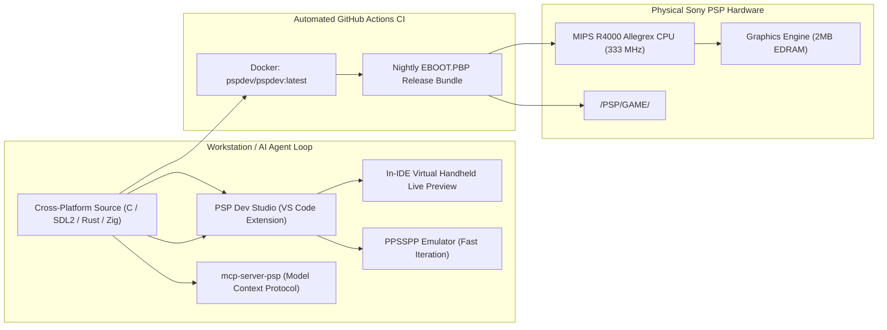

# 🕹️ PSP-Programming

  
  
  
  
  
  

  <strong>"The Modern PlayStation Portable Development & Porting Hub"</strong> 
  Cross-Platform Homebrew, In-IDE Multi-Model Handheld Preview, Model Context Protocol (MCP) Server, PS2-to-PSP Reverse Engineering Architecture, and Next-Gen Toolchains (C, SDL2, Rust & Zig).

---

## 🚀 Key Features in this Repository

### 📱 1. Official VS Code Extension: `PSP Dev Studio`
Located in [`extensions/vscode-psp-toolkit/`](extensions/vscode-psp-toolkit/):
* **In-IDE Multi-Model Live Preview (`📱`)**: Run interactive 60 FPS WebAssembly canvas graphics directly inside your editor. Switch between **Frameless**, **PSP-1000 ("Phat")**, **PSP Go (Slider)**, and **PSP Street (E1000)** with real-time on-screen clickable touch controls!
* **Top-Bar Instant Emulator Runner (`▶`)**: One-click build and execution directly into desktop **PPSSPP**.
* **Environment Doctor & Dashboard (`📊`)**: Scans your PATH for compilers and emulators with automated single-click installs via `winget` (Windows 11), `brew` (macOS), or `flatpak` (Linux).

### 🤖 2. Model Context Protocol (MCP) Server: `mcp-server-psp`
Located in [`mcp-server-psp/`](mcp-server-psp/):
* Equips AI agents (Claude, Cursor, Antigravity, VS Code Copilot) with native PSP hardware guardrails.
* **Tools exposed**:
  - `psp_hardware_lint`: Verifies 32MB RAM baseline, VRAM padding, power-of-2 texture dimensions (max 512x512), and VBlank sync.
  - `ps2_to_psp_transpile_advice`: Analyzes PS2 Emotion Engine (MIPS R5900) and VU0/VU1 microcode to generate PSP Allegrex R4000 & VFPU conversion recipes.
  - `psp_scaffold_project`: Generates boilerplate templates with build configs in C, SDL2, Rust, or Zig.
  - `psp_launch_emulator`: Triggers builds and launches PPSSPP programmatically.

### 🛡️ 3. Universal Hardware Compatibility Layer
Located in [`shared/`](shared/):
* Adopts the **PSP-1000 (32MB RAM)** as the universal baseline so your homebrew runs on 100% of physical PSP consoles.
* Provides runtime detection (`pspCompatHasExtendedRam()`) to dynamically scale memory and features on 64MB models (Slim, Brite, Go, Street).
* Includes Wi-Fi safety guards to prevent crashing on the network-less PSP Street (E1000).

### 🔄 4. PS2-to-PSP Reverse Engineering Architecture
Read our comprehensive technical guide on how modern REA agents and decompilers port PS2 titles to the PSP:
* Read the [PS2 to PSP Porting Manifesto](docs/porting_guide/ps2_to_psp_rea.md).
* Covers 128-bit SIMD to 32-bit VFPU transpilations, texture memory budgeting ($4\text{MB} \to 2\text{MB}$), and Little-Endian MIPS binary compatibility.

### ⚡ 5. Automated GitHub Actions CI/CD Nightly Builds
Every commit triggers our GitHub Actions pipeline (`.github/workflows/build.yml`) using the official `pspdev/pspdev` container, automatically compiling all demos and publishing a **Nightly EBOOT Pack** under Workflow Artifacts.

---

## ⚡ Technical Architecture: Dual-Pipeline Development

---

## 📦 Project Gallery

| Project | Stack | Description | Preview |
| :--- | :--- | :--- | :--- |
| **Debug Screen Colors** | C / PSPSDK | Kernel callbacks, text formatting, and hex color palettes | [Inspect](psp_projects/debug_screen_colors_psp) |
| **3D Cube** | C / PSP GU | Hardware 3D rendering with dynamic matrix rotation |  |
| **Texture Mapping** | C / PSP GU | Hardware-accelerated texture binding and UV mapping |  |
| **SDL2 TTF** | SDL2 / TTF | High-resolution TrueType vector font rendering |  |
| **SDL2 Mixer** | SDL2 | Multi-track audio playback with pause/resume loops |  |
| **OpenGL Triangle** | GLES / GU | Modern graphics pipeline emulation on PSP hardware |  |
| **Audio SPU** | Native SPU | Direct hardware audio streaming (PCM/WAV) |  |
| **SDL2 Image** | SDL2 | Loading and displaying PNGs via `SDL2_image` |  |
| **Input Debug** | C / PSP Ctrl | Reading controller state and drawing dynamic shapes |  |
| **Sprite Logic** | C / GU | Handling positioning and movement of 2D assets |  |
| **SDL2 Squares** | SDL2 | Basic square rendering and input loop handling |  |
| **Basic Geometry** | C / GU | Drawing primitives (rectangles) on clean background |  |
| **Zig Cube** | Zig-PSP | Zero-dependency modern systems programming for MIPS | [Inspect](psp_projects/zig_cube_psp) |
| **Rust Sample** | rust-psp | Memory-safe `#![no_std]` game loop targeting MIPS | [Inspect](psp_projects/rust_sample_psp) |

---

## 🛠️ Build Workflow

### Using the VS Code Extension
1. Open this repository in VS Code or Antigravity.
2. Open any source file in `psp_projects/<project_name>/`.
3. Click the **Device Icon (`📱`)** in the top-right header for the In-IDE Live Web Preview.
4. Click the **Play (`▶`)** button to launch in desktop PPSSPP, or run `Ctrl+Shift+B`.

### Command Line
1. **Navigate** to a project: `cd psp_projects/hello_world_psp`
2. **Generate Build Files:**
   * **For PSP:** `mkdir build && cd build && psp-cmake ..`
   * **For PC:** `mkdir build && cd build && cmake ..`
3. **Compile:** `make`
4. **Deploy:**
   * **On Emulator:** Launch `build/EBOOT.PBP` in PPSSPP.
   * **On Physical PSP:** Copy `build/EBOOT.PBP` to `X:/PSP/GAME/<PROJECT_NAME>/EBOOT.PBP`.

---

## 🗺️ Project Roadmap

- [x] **Automated CI/CD**: Nightly compilation of all homebrew projects with downloadable EBOOT artifacts.
- [x] **PS2-to-PSP Porting Manifesto**: Architecture guides for decompilation and REA targeting Allegrex hardware.
- [x] **Universal Compatibility Layer**: 32MB RAM baseline floor with progressive 64MB scaling.
- [x] **Model Context Protocol (MCP) Server**: AI agent tool provider for hardware linting & porting recipes.
- [x] **VS Code Extension (`PSP Dev Studio`)**: Top-bar instant run button, doctor diagnostics, and multi-model live preview.
- [ ] **Marketplace Packaging (`.vsix`)**: Package the VS Code extension for one-click marketplace install.
- [ ] **Standalone Windows 11 Automated Installer**: 1-click script bundling PPSSPP and toolchain configurations.
- [ ] **PSP Ad-Hoc $\leftrightarrow$ PC Cross-Play Networking Demo**: Real-time multiplayer socket packets between PSP and PC.

---

## 📜 Acknowledgments
* Special thanks to the **PSPDev Community**, the developers of **rust-psp** and **Zig-PSP**, and the **PPSSPP** project.
* Created & maintained by [Robert Fernandez](https://github.com/robfernan).
