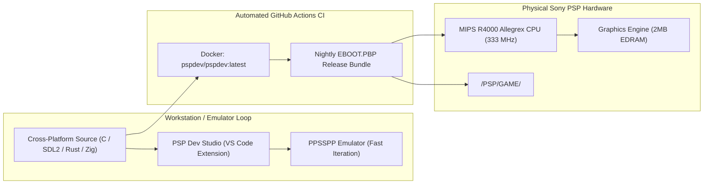

# 🕹️ PSP-Programming

  
  
  
  
  

  <strong>"The Modern PlayStation Portable Development & Porting Hub"</strong> 
  Cross-Platform Homebrew, PS2-to-PSP Reverse Engineering Architecture, VS Code Extension, Automated CI/CD, and Next-Gen Toolchains (C, SDL2, Rust & Zig).

---

## 🚀 Highlights & Features

### 🧩 1. Official VS Code Extension: `PSP Dev Studio`
Included in [`extensions/vscode-psp-toolkit/`](extensions/vscode-psp-toolkit/):
* **Top-Bar Quick Play (`▶`)**: One-click build and launch of the active project directly into the **PPSSPP** emulator.
* **Environment Doctor & Dashboard (`📊`)**: Interactive diagnostic window checking MIPS compilers, CMake, and emulator installation with automatic auto-install via `winget` (Windows) / `brew` (macOS) / `flatpak` (Linux).
* **Cross-Platform**: Zero configuration needed on Windows 11, macOS, and Linux.

### 🔄 2. PS2-to-PSP Reverse Engineering & Porting Architecture
Explore our technical manifesto on how modern REA agents, decompilation pipelines, and emulators translate PlayStation 2 (Emotion Engine MIPS R5900) games to run natively on PSP (Allegrex R4000) hardware:
* Read the [PS2 to PSP Porting Manifesto](docs/porting_guide/ps2_to_psp_rea.md).
* Covers instruction downscaling, VU0/VU1 microcode mapping to VFPU, and VRAM memory budgeting ($4\text{MB} \to 2\text{MB}$).

### ⚡ 3. Automated CI/CD Nightly Builds
Every push triggers our GitHub Actions pipeline (`.github/workflows/build.yml`) inside the official `pspdev/pspdev` container, compiling all demos and publishing a **Nightly EBOOT Pack** downloadable under Workflow Artifacts.

### 🤖 4. Antigravity & Agent AI Ready
Includes a dedicated AI skill in [`.agents/skills/psp-dev`](.agents/skills/psp-dev/SKILL.md) that teaches AI coding assistants PSP hardware limits (32MB RAM, VRAM pitch padding, power-of-2 textures, and kernel exit callbacks) to pair-program without crashing hardware.

---

## ⚡ Technical Architecture: Dual-Pipeline Development

---

## 📦 Project Gallery

| Project | Stack | Description | Preview |
| :--- | :--- | :--- | :--- |
| **Debug Screen Colors** | C / PSPSDK | Kernel callbacks, text formatting, and hex color palettes | [Inspect](psp_projects/debug_screen_colors_psp) |
| **3D Cube** | C / PSP GU | Hardware 3D rendering with dynamic matrix rotation |  |
| **Texture Mapping** | C / PSP GU | Hardware-accelerated texture binding and UV mapping |  |
| **SDL2 TTF** | SDL2 / TTF | High-resolution TrueType vector font rendering |  |
| **SDL2 Mixer** | SDL2 | Multi-track audio playback with pause/resume loops |  |
| **OpenGL Triangle** | GLES / GU | Modern graphics pipeline emulation on PSP hardware |  |
| **Audio SPU** | Native SPU | Direct hardware audio streaming (PCM/WAV) |  |
| **SDL2 Image** | SDL2 | Loading and displaying PNGs via `SDL2_image` |  |
| **Input Debug** | C / PSP Ctrl | Reading controller state and drawing dynamic shapes |  |
| **Sprite Logic** | C / GU | Handling positioning and movement of 2D assets |  |
| **SDL2 Squares** | SDL2 | Basic square rendering and input loop handling |  |
| **Basic Geometry** | C / GU | Drawing primitives (rectangles) on clean background |  |
| **Zig Cube** | Zig-PSP | Zero-dependency modern systems programming for MIPS | [Inspect](psp_projects/zig_cube_psp) |
| **Rust Sample** | rust-psp | Memory-safe `#![no_std]` game loop targeting MIPS | [Inspect](psp_projects/rust_sample_psp) |

---

## 🛠️ Build Workflow

### Using the VS Code Extension
1. Open this repository in VS Code.
2. Open any file in `psp_projects/<project_name>/`.
3. Click the **Play (`▶`)** button in the top-right header, or run `Ctrl+Shift+B`.

### Command Line
1. **Navigate** to a project: `cd psp_projects/hello_world_psp`
2. **Generate Build Files:**
   * **For PSP:** `mkdir build && cd build && psp-cmake ..`
   * **For PC:** `mkdir build && cd build && cmake ..`
3. **Compile:** `make`
4. **Deploy:**
   * **On Emulator:** Launch `build/EBOOT.PBP` in PPSSPP.
   * **On Physical PSP:** Copy `build/EBOOT.PBP` to `X:/PSP/GAME/<PROJECT_NAME>/EBOOT.PBP`.

---

## 🗺️ Project Roadmap

- [x] **Automated CI/CD**: Nightly compilation of all homebrew projects with downloadable EBOOT artifacts.
- [x] **PS2-to-PSP Porting Manifesto**: Architecture guides for decompilation and REA targeting Allegrex hardware.
- [x] **VS Code Extension (`PSP Dev Studio`)**: Top-bar instant run button and diagnostics webview.
- [ ] **Marketplace Packaging (`.vsix`)**: Package the VS Code extension for one-click marketplace install.
- [ ] **In-Browser PPSSPP WASM Player**: Embedded playable demo directly on GitHub Pages.
- [ ] **Standalone Windows MSI Installer**: Automated bundled installer for PPSSPP, toolchain paths, and VS Code extension.
- [ ] **Cross-Play Networking Demo**: Ad-Hoc socket communication between PSP and PC client.

---

## 📜 Acknowledgments
* Special thanks to the **PSPDev Community**, the developers of **rust-psp** and **Zig-PSP**, and the **PPSSPP** project.
* Created & maintained by [Robert Fernandez](https://github.com/robfernan).
