# 🕹️ PSP-Programming

<p align="center">
  
  
  
  
  
  
</p>

<p align="center">
  <strong>C and SDL2 homebrew you can build for a PlayStation Portable.</strong><br>
  The <code>psp_projects/</code> folder is a set of PSPSDK and SDL2 samples, each with its own build notes, plus a minimal <code>rust-psp</code> crate. A VS Code extension and a Model Context Protocol server live in this repo for local use. Marketplace publishing for the extension is still on the roadmap.
</p>

<p align="center">
  <sub>If a sample here gets an EBOOT onto your PSP, a star helps the next person find it.</sub>
</p>

---

**Start here:** [Hello World](psp_projects/hello_world_psp) (PSPSDK debug screen) and [SDL2 square](psp_projects/sdl_square_psp) (one source tree for PSP and desktop). Follow the README in the sample folder. The command-line steps below match those tutorials.

## On screen

Screenshots from the sample folders, as run in PPSSPP. Open a tile for that sample's tutorial.

<table>
  <tr>
    <td align="center" width="25%">
      <a href="psp_projects/cube_3d_psp">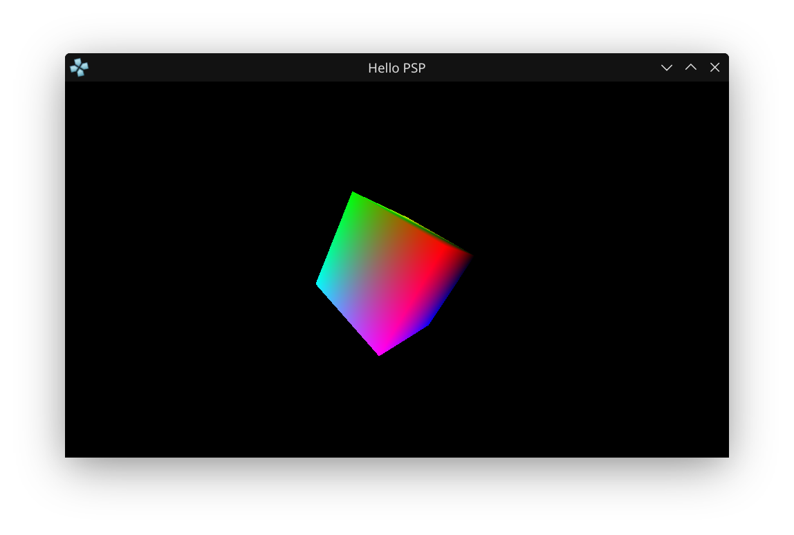</a><br>
      <a href="psp_projects/cube_3d_psp"><b>3D Cube</b></a><br>
      <sub>C / GU · analog rotate</sub>
    </td>
    <td align="center" width="25%">
      <a href="psp_projects/texture_mapping_psp">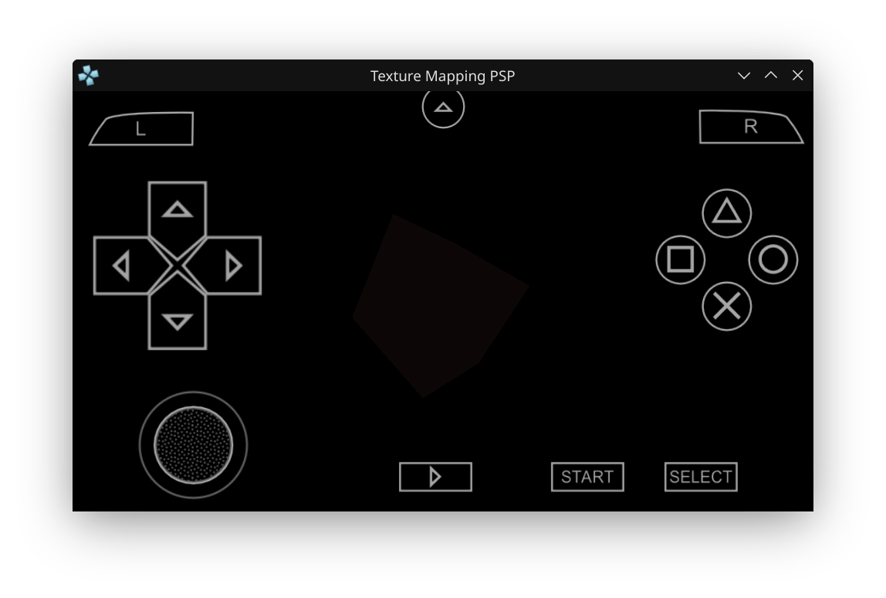</a><br>
      <a href="psp_projects/texture_mapping_psp"><b>Texture Map</b></a><br>
      <sub>C / GU · UV binding</sub>
    </td>
    <td align="center" width="25%">
      <a href="psp_projects/opengl_triangle_psp">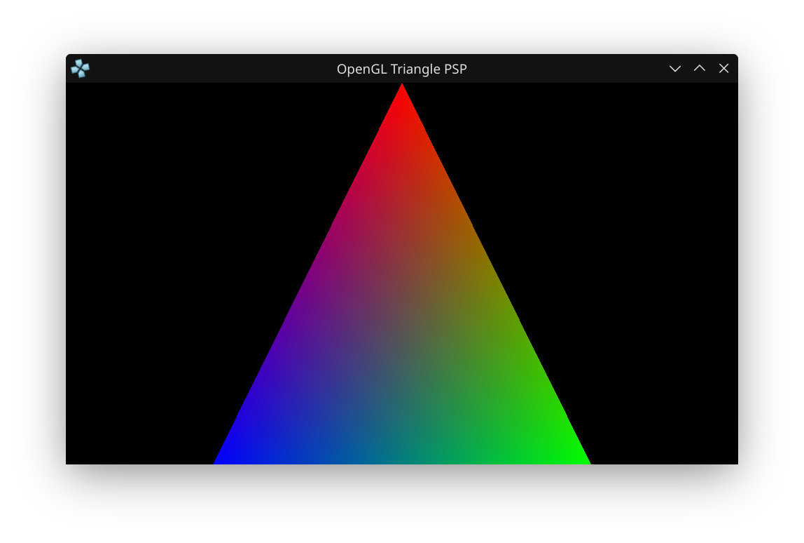</a><br>
      <a href="psp_projects/opengl_triangle_psp"><b>Colored Triangle</b></a><br>
      <sub>C / GU</sub>
    </td>
    <td align="center" width="25%">
      <a href="psp_projects/drawing_sprite_psp">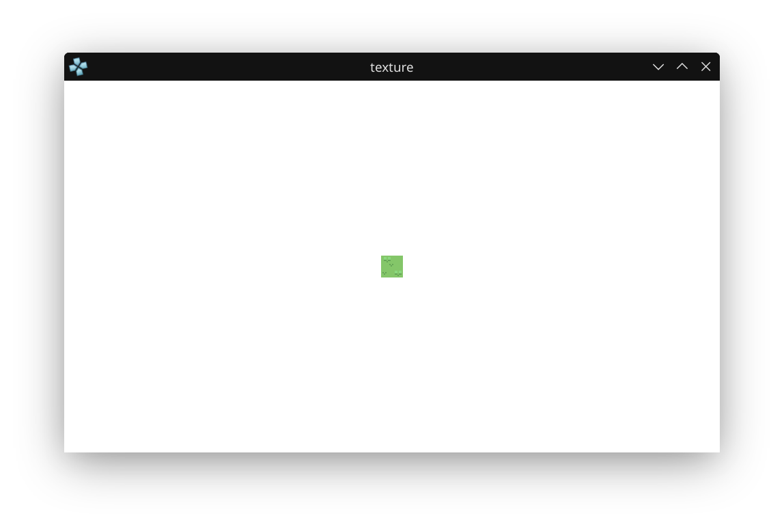</a><br>
      <a href="psp_projects/drawing_sprite_psp"><b>Sprite</b></a><br>
      <sub>C / GU · PNG texture</sub>
    </td>
  </tr>
  <tr>
    <td align="center">
      <a href="psp_projects/sdl_ttf_psp">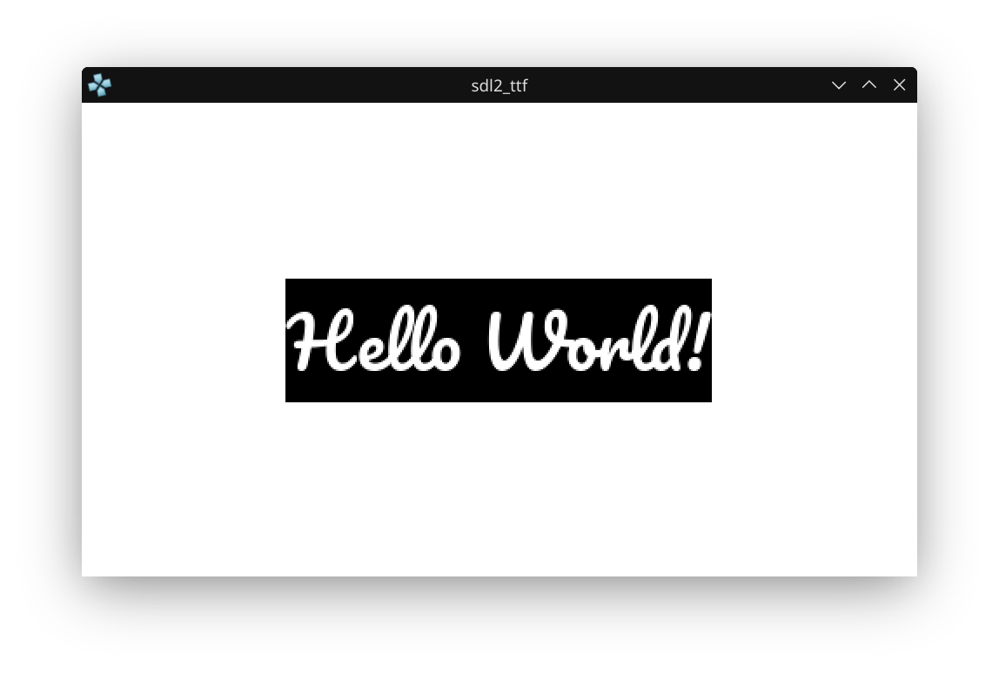</a><br>
      <a href="psp_projects/sdl_ttf_psp"><b>SDL2 TTF</b></a><br>
      <sub>SDL2_ttf · PSP and desktop</sub>
    </td>
    <td align="center">
      <a href="psp_projects/sdl_image_psp">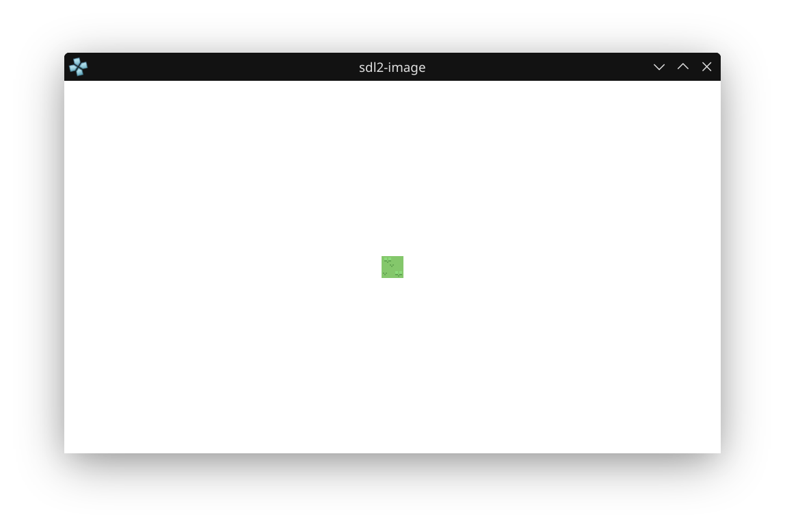</a><br>
      <a href="psp_projects/sdl_image_psp"><b>SDL2 Image</b></a><br>
      <sub>SDL2_image · PNG</sub>
    </td>
    <td align="center">
      <a href="psp_projects/sdl_square_psp">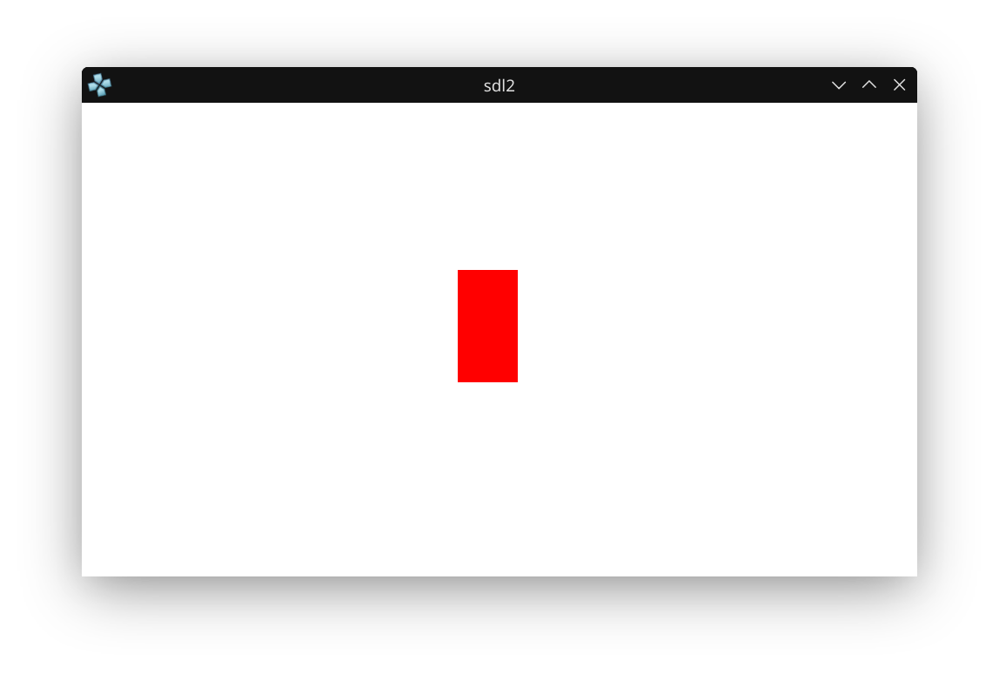</a><br>
      <a href="psp_projects/sdl_square_psp"><b>SDL2 Square</b></a><br>
      <sub>SDL2 · PSP and desktop</sub>
    </td>
    <td align="center">
      <a href="psp_projects/sdl_mixer_psp">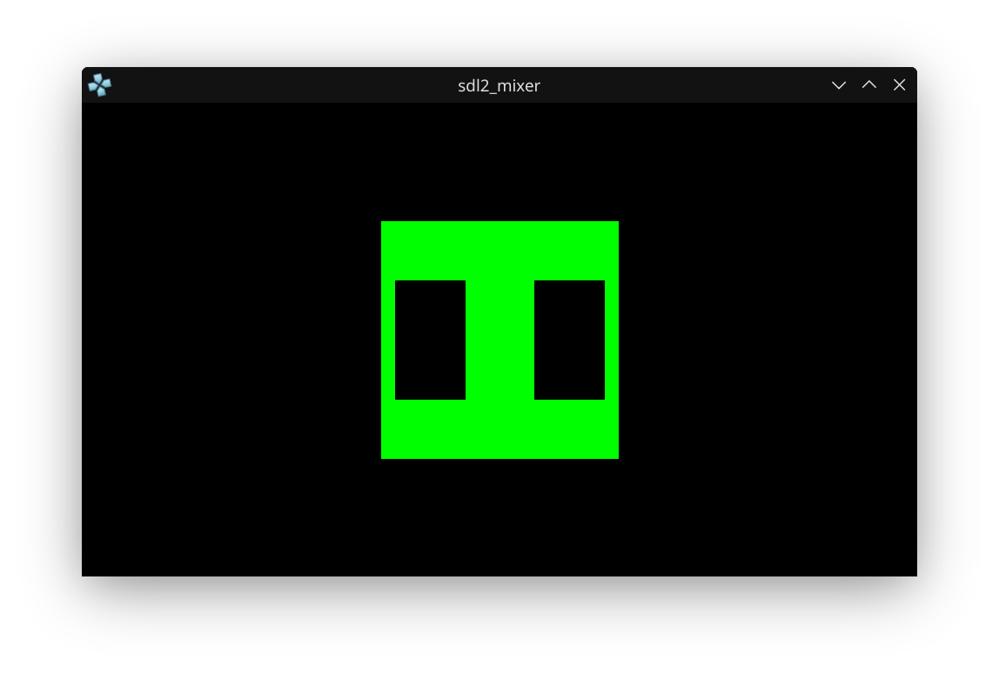</a><br>
      <a href="psp_projects/sdl_mixer_psp"><b>SDL2 Mixer</b></a><br>
      <sub>SDL2_mixer · pause and resume</sub>
    </td>
  </tr>
  <tr>
    <td align="center">
      <a href="psp_projects/audio_psp">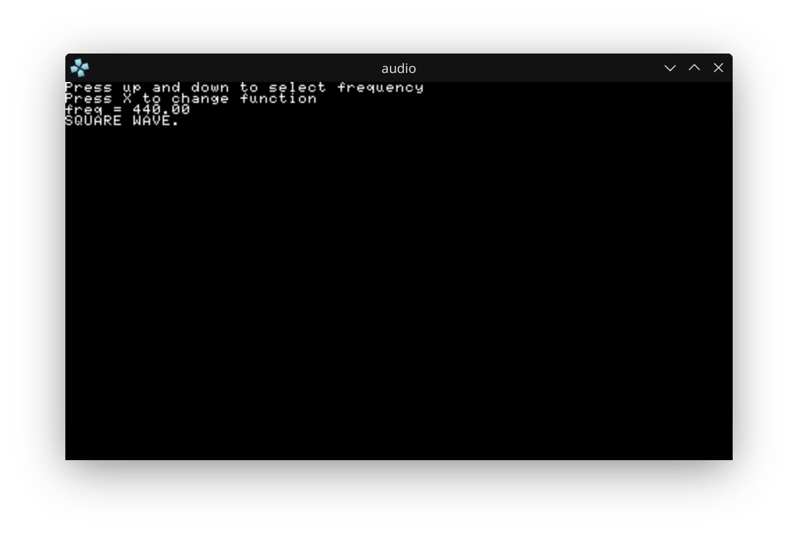</a><br>
      <a href="psp_projects/audio_psp"><b>Audio Synth</b></a><br>
      <sub>native audio · sine, square, triangle</sub>
    </td>
    <td align="center">
      <a href="psp_projects/drawing_input_psp">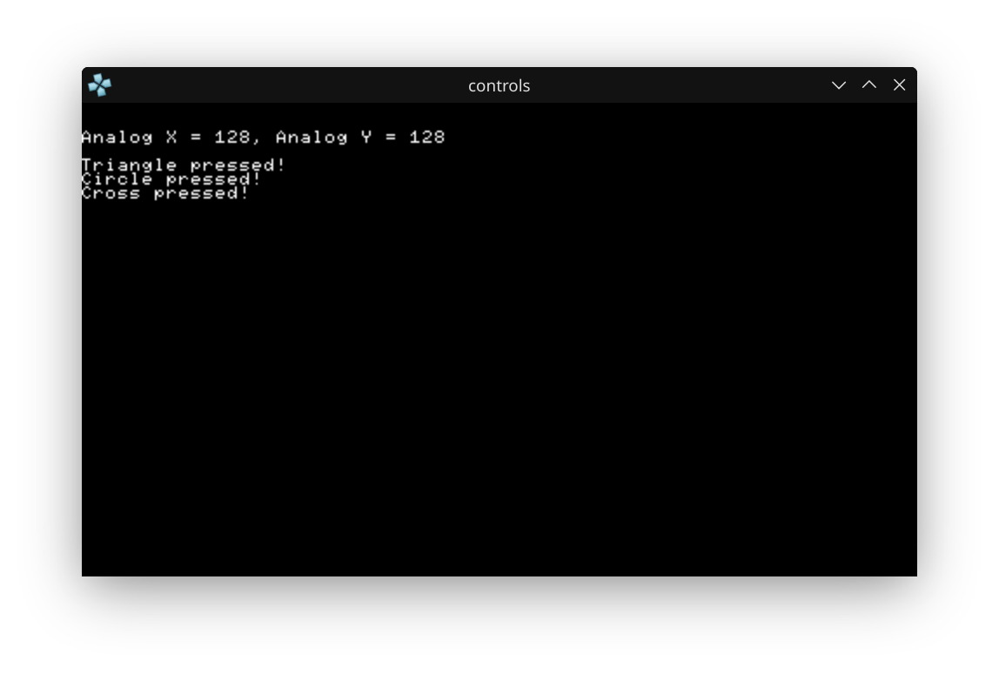</a><br>
      <a href="psp_projects/drawing_input_psp"><b>Controller</b></a><br>
      <sub>C / buttons and analog</sub>
    </td>
    <td align="center">
      <a href="psp_projects/drawing_square_psp">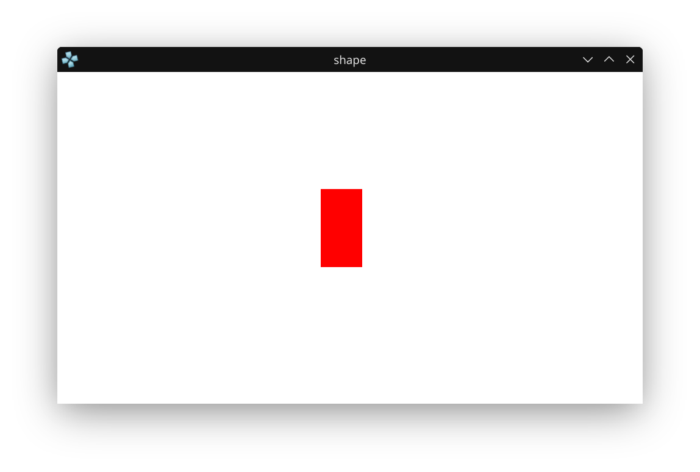</a><br>
      <a href="psp_projects/drawing_square_psp"><b>Rectangle</b></a><br>
      <sub>C / GU primitive</sub>
    </td>
    <td align="center">
      <a href="psp_projects/hello_world_psp">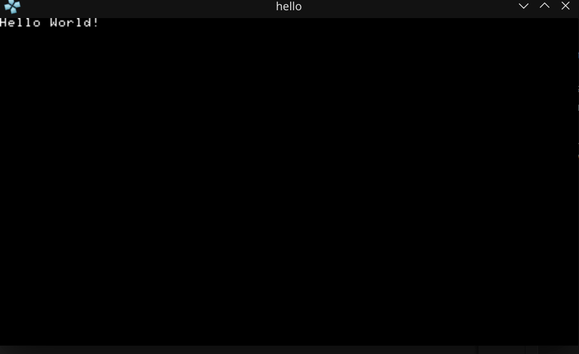</a><br>
      <a href="psp_projects/hello_world_psp"><b>Hello World</b></a><br>
      <sub>C / debug screen</sub>
    </td>
  </tr>
</table>

### Also under `psp_projects/`

| Project | What is in the folder |
| :--- | :--- |
| [debug_screen_colors_psp](psp_projects/debug_screen_colors_psp) | Debug-screen colors, kernel callbacks, and controller exit. No screenshot is checked in. |
| [rust_sample_psp](psp_projects/rust_sample_psp) | Minimal `rust-psp` 0.3 crate: `#![no_std]`, home button enabled, one vblank wait. |
| [crossplay_net_psp](psp_projects/crossplay_net_psp) | Early UDP sketch that uses the Wi-Fi guard in `shared/`. Finished cross-play is still on the roadmap. |

---

## Build

### Command line

1. **Navigate** to a project: `cd psp_projects/hello_world_psp`
2. **Generate build files** (run one of these from the project directory):
   * **For PSP:** `mkdir build && cd build && psp-cmake ..`
   * **For desktop SDL2 samples** (`sdl_square_psp`, `sdl_image_psp`, `sdl_mixer_psp`, `sdl_ttf_psp`): `mkdir build && cd build && cmake ..`
3. **Compile:** `make`
4. **Deploy:**
   * **On Emulator:** Launch `build/EBOOT.PBP` in PPSSPP.
   * **On Physical PSP:** Copy `build/EBOOT.PBP` to `X:/PSP/GAME/<PROJECT_NAME>/EBOOT.PBP`.

`psp-cmake` is the same entry the GitHub Actions workflow uses. Several sample READMEs also show `cmake .. -DCMAKE_TOOLCHAIN_FILE=~/pspdev/psp/share/pspdev.cmake` followed by `cmake --build .`. Either PSP form is fine when the PSPSDK is on your machine. Per-sample notes (assets, controls, and the desktop packages to install) stay in that sample's README.

### VS Code extension

The extension source and a local package are in [`extensions/vscode-psp-toolkit/`](extensions/vscode-psp-toolkit/). Install that package, then use the title-bar buttons. Publishing to the Marketplace is still on the roadmap.

```bash
code --install-extension extensions/vscode-psp-toolkit/vscode-psp-toolkit-1.0.0.vsix
```

1. Open this repository in VS Code or Antigravity.
2. Open any source file in `psp_projects/<project_name>/`.
3. Click the **device icon** in the editor title bar for the in-editor preview.
4. Click the **play icon**, or run **PSP: Run in PPSSPP**, to build and launch desktop PPSSPP.

The preview switches among frameless, PSP-1000, PSP Go, and PSP Street frames. Its screen is a built-in canvas scene: the D-pad (or arrow keys) moves it, and the face buttons change its color. The play command is what builds the open sample and starts PPSSPP. It looks for `CMakeLists.txt`, `Cargo.toml`, or `build.zig` above the active file.

**PSP: Auto-Install PPSSPP & Tools** checks a few known PPSSPP paths, then tries `winget` (Windows), `brew` (macOS), or `flatpak` (Linux). **PSP: Open Dev Studio Dashboard** opens the dashboard page shipped with the extension. [`setup_windows.ps1`](setup_windows.ps1) installs PPSSPP with winget when it is missing and installs this same `.vsix`.

---

## Also in this repo

### Hardware helpers

[`shared/`](shared/) targets the PSP-1000 32MB baseline and exposes `pspCompatHasExtendedRam()` and `pspCompatHasWifi()` so a build can scale on 64MB models and skip Wi-Fi init on the Street (E1000).

### PS2-to-PSP notes

[PS2 to PSP porting notes](docs/porting_guide/ps2_to_psp_rea.md) compare the Emotion Engine and Allegrex: 128-bit SIMD versus the 32-bit VFPU, 4MB GS eDRAM versus 2MB GE eDRAM, and the shared little-endian MIPS layout.

### CI

[`.github/workflows/build.yml`](.github/workflows/build.yml) runs on pushes to `main`, on pull requests, and on manual dispatch. The `pspdev/pspdev` container builds every `psp_projects/*` directory that has a `CMakeLists.txt` and uploads `EBOOT.PBP` files as the `psp-homebrew-nightly-eboot-pack` artifact (kept for 14 days). The `rust-psp` sample has no CMakeLists, so this workflow skips it.

### MCP server

[`mcp-server-psp/`](mcp-server-psp/) is a stdio JSON-RPC server (`tools/list`, `tools/call`) for an agent on your machine. It is not a published package.

| Tool | What the handler does |
| :--- | :--- |
| `psp_hardware_lint` | Reads the snippet for `sceDisplayWaitVblankStart` or `SDL_RenderPresent`, for a Home-button exit callback, and for optional texture width/height (power of two, max 512). |
| `ps2_to_psp_transpile_advice` | Returns a short checklist: 128-bit EE ops toward the VFPU, GS 4MB toward GE 2MB, little-endian struct layout, and 640×448 toward 480×272. |
| `psp_scaffold_project` | Returns a status payload naming the requested language (`c`, `sdl2`, `rust`, or `zig`). Copy a folder under `psp_projects/` when you want a real tree. |
| `psp_launch_emulator` | Returns a status payload naming the project path. Launching PPSSPP is the play command above, or opening `build/EBOOT.PBP` yourself. |

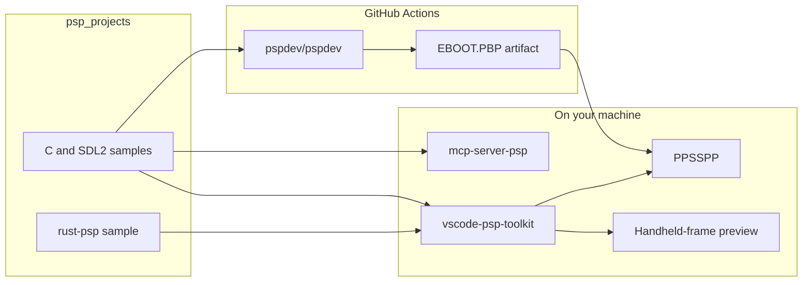

---

## Roadmap

- [x] **CI builds**: CMake samples compile in `pspdev/pspdev`, with `EBOOT.PBP` artifacts attached to the workflow run.
- [x] **PS2-to-PSP notes**: Architecture comparison for Allegrex porting work.
- [x] **32MB baseline helpers**: `shared/` model, RAM, and Wi-Fi checks.
- [x] **In-repo MCP server**: hardware lint and a PS2-to-PSP checklist over stdio.
- [x] **In-repo VS Code extension**: local `.vsix`, handheld-frame preview, and PPSSPP launch.
- [ ] **Marketplace publish**: list the extension so install does not depend on the `.vsix` in this repo.
- [ ] **Windows installer**: `setup_windows.ps1` covers PPSSPP and the local extension; a fuller toolchain installer is still open.
- [ ] **PSP and PC cross-play**: `crossplay_net_psp` is an early sketch, not a finished multiplayer demo.

## Acknowledgments

* Special thanks to the **PSPDev Community**, the developers of **rust-psp** and **Zig-PSP**, and the **PPSSPP** project.
* Created and maintained by [Robert Fernandez](https://github.com/robfernan).
* [MIT License](LICENSE).
