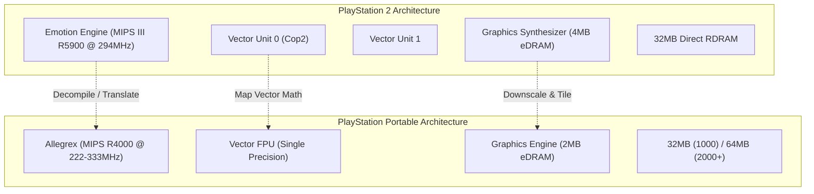

# 🔄 PS2-to-PSP Porting & Reverse Engineering Architecture

> **Context**: How modern reverse-engineering agents (REA/MCP) and decompilation pipelines target the PSP from PlayStation 2 (Emotion Engine) codebases, capitalizing on their shared MIPS heritage.

---

## 1. Architectural Parallels & Discrepancies

Both the **PlayStation 2 (Emotion Engine)** and **PlayStation Portable (Allegrex)** share MIPS architectural ancestry, making automated decompilation and porting feasible:

---

## 2. Porting Strategy Matrix

| System Component | PS2 (Emotion Engine) | PSP (Allegrex) | Translation Strategy |
| :--- | :--- | :--- | :--- |
| **Instruction Set** | MIPS III 64/128-bit SIMD (R5900) | MIPS II 32-bit (Allegrex) | Strip 128-bit multimedia opcodes; replace with 32-bit scalar or VFPU sequences. |
| **Geometry Math** | VU0 / VU1 Microcode | VFPU (Vector FPU) | Transpile VU microcode to inline VFPU assembly (`vfpu_asm`). |
| **Display Res** | $640 \times 448$ (Interlaced) | $480 \times 272$ (Progressive 60Hz) | Downsample assets; adjust projection matrix aspect ratio to 16:9 ($1.76:1$). |
| **VRAM Buffer** | 4MB eDRAM | 2MB eDRAM | Downscale textures to power-of-2 ($256 \times 256$ or $128 \times 128$); use 4-bit/8-bit indexed palettes (CLUT). |
| **Audio** | SPU2 (48 Channels) | SPU (Hardware PCM/ATRAC3) | Downmix multi-channel sound to stereo PCM streaming via `sceAudio`. |

---

## 3. Cross-Play & Network Sync

For multiplayer or cross-play interoperability (PSP Ad-Hoc $\leftrightarrow$ PC/Pro Online Client):
1. **Ad-Hoc Socket Emulation**: Route packets through `pspnet_adhoc` or virtual socket taps.
2. **Deterministic Simulation**: Ensure fixed-step physics loops (16.6ms / 60 FPS) to avoid desync between different platforms.
3. **Endianness**: Both PS2 and PSP are **Little-Endian MIPS**, meaning binary structs and packet layouts can be shared across memory without byte-swapping overhead.
